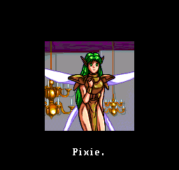
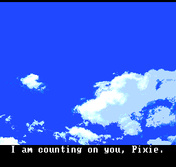
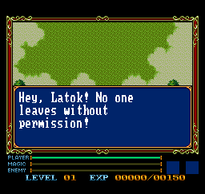
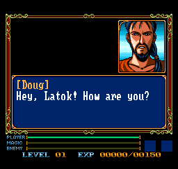

# Xak I & II — PC Engine CD English Patch

English dialogue, menus and cinematic subtitles for the Japanese PC Engine Super CD-ROM² compilation, with a larger dialogue font and pagination inside the original message boxes. Japanese voice acting and music are retained.

**The English script builds on existing MSX translations, not an original English localisation by this project:** Xak I uses the WOOMB.net translation by **Rieks Warendorp Torringa**; Xak II uses the **Oasis** translation as a reference. This release adapts that material to the PCE version and supplies PCE-specific text and subtitles. See [credits and translation sources](CREDITS.md).

## Download

[Download the patch package](https://github.com/randomprojectsfactory/xak-i-ii-pce-english/releases/latest/download/Xak-I-II-English-2026.10.27.1.zip)

Release: **2026.10.27.1**. The download contains two xdelta patches, a hash-checking patcher and documentation. **No BIN, CUE, ISO, BIOS, audio files or game disk images are distributed.**

This update corrects English text rendering in the Xak II portion and positions cinematic subtitles within the intended 224-line visible area. The original Japanese audio, disc layout and save format are retained.

## Features

- English story dialogue and interface text across both games, including shop interactions, item and spell descriptions, prices and system messages.
- English subtitles for the cinematic speech, with the original Japanese audio retained.
- English replacements or captions for graphic text, preserving distinctive artwork where appropriate.
- A larger dialogue font with complete lowercase descenders and additional pages for longer conversations.
- Native message acknowledgement, choices and event continuation retained through pagination.
- Display corrections for dialogue, subtitle updates and backup-memory menu transitions.

This is a text and speech-subtitle release. It does not add visual indicators for every nonverbal gameplay sound.

## Required original disc

Use **Xak (Japan), PC Engine CD**, in the exact **29-track, separate BIN/CUE layout** listed in [source-hashes.json](source-hashes.json). This is a raw 2352-byte-sector dump, not a single ISO. The two changed tracks must match:

| Original file | Bytes | SHA-256 |
| --- | ---: | --- |
| `Xak (Japan) (Track 02).bin` | 1,827,504 | `d952266c7a950b023ef5efcbfcf3c469131f0108f21bd90662f70524ff1fa624` |
| `Xak (Japan) (Track 05).bin` | 24,947,664 | `8433df96f1c3c43bf7e4edc7a72eadba329cb47efab8a8ad47d718b6617cc2f9` |

The SHA-256 of the original raw track bytes concatenated in track order, 01 through 29, is:

```text
dd778ff76546bb84f023c359bccac585dd404e5338945d6b2f20c5ff13d6f1a4
```

That combined value identifies this ordered raw-track set; it is **not an ISO-file hash**. The manifest provides each individual track's hash, so no combined image needs to be created. Keep all original tracks, including pregap data. Do not apply these patches to an already translated image, a previous release, a merged BIN or a converted ISO.

## System Card compatibility

The save/load display correction uses the System Card 3 BIOS layout. The BIOS used for emulator and Turbo EverDrive Pro hardware validation has this SHA-256:

```text
e11527b3b96ce112a037138988ca72fd117a6b0779c2480d9e03eaebece3d9ce
```

Other BIOS revisions are unverified. Supply your own BIOS where required by your emulator or device; none is included in this package.

## Apply the patch

Install Python 3 and [xdelta3](https://github.com/jmacd/xdelta/releases), then extract the patch package. Put `xdelta3` on your system's PATH.

Check your original dump:

```sh
python3 apply_patch.py "/path/to/original-disc-folder" --check
```

Create a translated copy in a new folder:

```sh
python3 apply_patch.py "/path/to/original-disc-folder" "/path/to/Xak-English"
```

On Windows, use `py -3` instead of `python3` if appropriate. The patcher verifies every source track, applies both patches, verifies the results and copies the unchanged tracks. It creates `Xak.cue` from your original CUE with normalized line endings. Launch that CUE and keep all 29 BIN files beside it. Your original folder is left intact.

For manual patching, use an xdelta3-compatible patcher on Tracks 02 and 05 separately, selecting the matching patch for each original track. Preserve every other track and the original CUE layout. Compare the results with the patched hashes in the manifest.

## Cinematic subtitles






## Larger dialogue font





Screenshots are emulator captures; displayed at twice their native width for readability.

## About the adaptation

The PCE edition has its own executable code, text layout, graphics and voiced scenes. Bringing the MSX English text across required a new text system, script adaptation, subtitles and display-timing work. [Development notes](DEVELOPMENT.md) explain the main difficulties and the changes made.

Original games: Microcabin. PC Engine edition: RIOT / Telenet Japan. Existing English translations belong to their respective authors. This is an unofficial adaptation, with no affiliation or endorsement implied.
